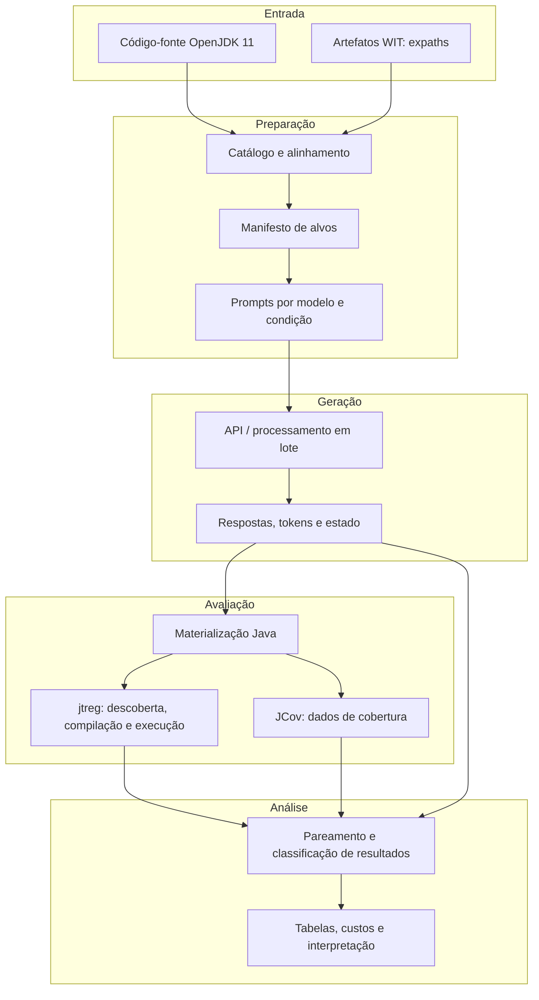

# Arquitetura do experimento

## 1. Visão geral

A arquitetura organiza a pesquisa em etapas rastreáveis: seleção de métodos, preparação de prompts, geração, execução e análise. Uma rodada específica pode utilizar scripts e infraestrutura diferentes; os registros dessa rodada são a fonte de verdade para sua reprodução.

## 2. Componentes e responsabilidades

| Componente | Responsabilidade | Evidência produzida |
|---|---|---|
| Código-fonte e WIT | Fornecer métodos e hipóteses de condições excepcionais | Versão do projeto e artefatos WIT |
| Catálogo e alinhamento | Identificar e relacionar métodos disponíveis nos dois insumos | Identificadores e manifesto de seleção |
| Preparação | Montar requisições para cada condição e modelo | Prompts, parâmetros e IDs de requisição |
| Provedores | Gerar respostas, inclusive por processamento em lote quando aplicável | Respostas, estados e uso de tokens |
| Materialização e jtreg | Preparar arquivos Java e registrar descoberta e execução | Testes, logs e resultados jtreg |
| JCov e análise | Coletar cobertura e comparar resultados pareados | XMLs, manifestos, tabelas e relatórios |

O caminho crítico para auditoria é **método → condição → requisição → resposta → teste → execução → cobertura**. Preservar identificadores e versões em cada etapa permite rastrear uma observação até seus insumos.

## 3. Condições comparadas

Para cada método elegível, o cenário `direct-tests` solicita testes a partir do código, enquanto `wit-context` também apresenta hipóteses WIT. Os prompts históricos têm diferenças de redação e conteúdo além da presença dos expaths; a comparação mede o efeito das condições completas de geração.

## 4. Organização do código

| Local | Responsabilidade principal |
|---|---|
| `internal/dominio` | Tipos e conceitos compartilhados |
| `internal/aplicacao` | Orquestração, preparação de estudos e prompts |
| `internal/catalogo` e `internal/witup` | Catálogo de métodos e leitura de artefatos WIT |
| `internal/llm` | Comunicação com provedores e processamento de requisições |
| `internal/metricas` | Execução e extração de métricas |
| `scripts/` e `docker/` | Preparação, execução e análise de rodadas específicas |

Consulte o [método](../studies/metodo.md) para o desenho experimental e a [reprodutibilidade](../studies/reprodutibilidade.md) para os requisitos de proveniência. As setas representam o fluxo conceitual; não implicam que cada rodada tenha usado a mesma implementação ou infraestrutura.
