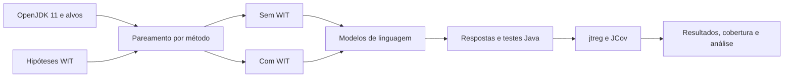

# WIT + LLM: geração de testes para comportamentos excepcionais

Este projeto de pesquisa investiga como informações de análise estática influenciam a geração de testes Java por modelos de linguagem. O objeto principal é o **OpenJDK 11**; os testes são avaliados com **jtreg**, e a cobertura é investigada com **JCov**.

!!! abstract "Objetivo"
    Avaliar, para os mesmos métodos-alvo, as diferenças entre testes gerados com informações de caminhos excepcionais identificadas pelo WIT e testes gerados diretamente a partir do código, considerando diferentes modelos e as limitações dos protocolos utilizados.

## Perguntas de pesquisa

1. Como a inclusão de informações WIT se relaciona à aprovação, aos erros de compilação e à cobertura dos testes gerados?
2. Como os resultados diferem entre modelos, considerando as diferenças de configuração e de execução das rodadas?

A hipótese de trabalho é que o contexto WIT pode orientar a geração para condições excepcionais. A hipótese deve ser confrontada com os dados: não se presume que o contexto melhore todas as métricas.

## Visão geral do experimento

O estudo considera GPT-4.1 nano, GPT-4.1 mini e Claude Haiku 5.5. As rodadas históricas apresentam diferenças de orçamento de saída, configuração de geração e processamento; uma comparação entre modelos não isola automaticamente o efeito do modelo.

!!! warning "Estado dos resultados"
    O estudo está em andamento. A reexecução e a validação da cobertura são necessárias para comparações consistentes. A página de [piloto histórico](studies/jdk-global-impact.md) descreve uma rodada anterior, distinta da coorte atual.

## Roteiro de leitura

- [Arquitetura do experimento](architecture/index.md): componentes, fluxos de dados e artefatos.
- [Método experimental](studies/metodo.md): objetivo, condições, prompts e procedimento.
- [Métricas e análise](studies/metricas.md): definições, denominadores e limites de interpretação.
- [Reprodutibilidade](studies/reprodutibilidade.md): ambientes, proveniência e validação.
- [Primeiros passos](overview/getting-started.md): preparação e uso da ferramenta.
